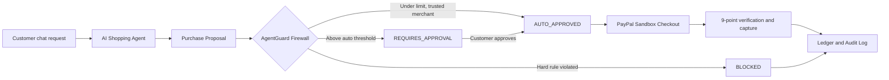
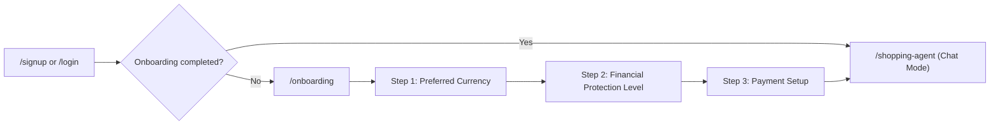

# AgentGuard AI — The AI Payment Firewall

> **"Let AI spend. You stay in control."**

**AgentGuard AI** is a full-stack financial security and authorization firewall that sits between autonomous AI shopping agents and PayPal. AI agents can discover products, compare specifications, and prepare purchase proposals, but **AgentGuard AI deterministically controls whether money is allowed to move**.

---

## 0. Project Overview

| | |
|---|---|
| **Problem** | AI shopping agents can be tricked, can hallucinate, or can overspend. Giving them direct payment authority is unsafe. |
| **Solution** | A firewall between the agent and PayPal. Every purchase proposal is checked by deterministic spending rules and an AI risk engine, and then it is auto-approved, sent to a human, or blocked. |
| **Key idea** | The AI proposes. AgentGuard decides. The human approves. PayPal only moves money after all three agree. |
| **Two portals** | **Client Portal** for customers who own the money. **Admin Console** for operators who monitor the platform. |
| **Payments** | Live PayPal Sandbox through the official PayPal JS SDK and the REST Orders v2 API. |

### At a glance



---

## 1. Central Innovation & Architecture

```text
Customer Request
  → AI Shopping Agent (OpenAI + PayPal Agent Toolkit Read/Prep Tools)
  → Purchase Proposal
  → AgentGuard Financial Firewall
  → Deterministic Server-Side Policy Validation (Integer Minor Units + Atomic Reservations)
  → AI Risk Intelligence Engine (Zod-Validated 0–100 Threat Scoring)
  → 3-State Firewall Decision (AUTO_APPROVED | REQUIRES_APPROVAL | BLOCKED)
  → Cryptographic Single-Use Human Approval (if required)
  → PayPal Sandbox Checkout (official JS SDK + Orders v2 API)
  → 9-Point Server Re-Verification & Payment Capture
  → Append-Only Audit Log & Transaction Ledger (MongoDB: paypal-hackathon)
```

### Core Security Invariants
1. **Deterministic Policy Supremacy**: Hard spending limits (maximum single transaction, daily/weekly/monthly budgets, blocked merchants, duplicate transaction detection) are enforced by deterministic server-side code in integer minor currency units. An AI model can never override a policy violation.
2. **No Unrestricted AI Capture Authority**: The AI Shopping Agent is explicitly denied `pay_order` and direct payment capture tools in [`agent-toolkit.ts`](src/lib/paypal/agent-toolkit.ts). The capture route also rejects any request with `actorRole: "AGENT"`.
3. **9-Point Backend Capture Verification**: Before capturing a PayPal order in [`paypal.service.ts`](src/services/paypal.service.ts), the backend independently verifies:
   - Authenticated customer session (never AI agent)
   - Transaction ownership (`userId` match)
   - Valid purchase proposal (`proposalId`)
   - Current financial policy re-validation
   - Single-use, non-expired, cryptographically bound human approval (when required)
   - Exact amount and currency match against the server-side proposal (browser-submitted tampering is rejected)
   - Merchant and PayPal Order details
   - Idempotency key (`PayPal-Request-Id`)
   - Valid state transition (`PAYPAL_ORDER_CREATED` / `CUSTOMER_CHECKOUT_APPROVED` → `COMPLETED`)

---

## 2. Client Side (Customer Portal)

Customers sign in at `/login`, finish a 3-step onboarding wizard (`/onboarding`), and land in the **ChatGPT-style AI Shopping Agent** by default. A **FIREWALL ACTIVE SETTING** toggle in the chat header opens the full dashboard.

### Onboarding Route (`/onboarding`)

New customers who have not finished setup are sent to `/onboarding` right after sign-up or login. Completed users skip it and go straight to `/shopping-agent`. Administrators always go to `/admin/dashboard`.



| Step | Screen | What the customer does |
|---|---|---|
| **1** | Preferred Currency | Choose the currency used for limits, approvals, and receipts (default `INR`). |
| **2** | Financial Protection Level | Pick a preset (Conservative, Balanced, Flexible) or customize the maximum transaction amount, daily/weekly/monthly limits, auto-approval threshold, trusted and blocked merchants, and duplicate protection. Inputs are validated before continuing. |
| **3** | Payment Setup | Enable PayPal Sandbox Checkout for approved AI purchases. |

**Onboarding UI behavior**
- A **Step N of 3** progress bar at the top. Click any step to jump to it.
- **Progress is saved automatically** to the user profile (`onboardingStep`, `onboardingDraft`) and also to `localStorage`. If the customer signs out or closes the tab, they resume at the same step with their draft values restored.
- Signing out mid-way shows: *"Signed out. Your progress at Step N of 3 has been saved."*
- A **Light / Dark** theme toggle is available on every step.
- Finishing step 3 creates the customer's financial policy, marks `onboardingCompleted`, and opens **Chat Mode**.
- Route guard: the client portal redirects customers back to `/onboarding` until it is complete.

| Related route | Purpose |
|---|---|
| `/onboarding` | 3-step setup wizard (UI) |
| `POST /api/onboarding` | Saves progress and completes setup |
| `GET /api/auth/session` | Returns `onboardingCompleted`, `onboardingStep`, `onboardingDraft` |

| Page | Route | Purpose |
|---|---|---|
| **Onboarding** | `/onboarding` | 3-step setup wizard: currency, protection level, PayPal setup. Progress is saved automatically. |
| **AI Shopping Agent** | `/shopping-agent` | Single-page chat UI. Only the chat stream and the sidebar list scroll. Includes 4 hackathon demo scenarios, Recents (with delete), and **Evaluated Products**. |
| **Overview** | `/dashboard` | Firewall status, spend vs. limits, recent decisions. |
| **My AI Agents** | `/agents` | Register, pause, and manage AI agents and their permissions. |
| **Financial Policies** | `/policies` | Presets (Conservative, Balanced, Flexible) and custom limits, trusted and blocked merchants, auto-approval threshold, duplicate protection. |
| **Pending Approvals** | `/approvals` | Approve or reject single-use, 30-minute approval requests. |
| **Transactions** | `/transactions` | Full ledger with firewall decision, risk score, PayPal order and capture IDs. |
| **Risk Intelligence** | `/risk` | AI risk scores, signals, and security alerts. |
| **Notifications** | `/notifications` | Firewall, approval, and PayPal webhook alerts. |
| **PayPal Connection** | `/paypal` | Sandbox configuration and connection status. |
| **Profile & Settings** | `/settings` | Profile, currency (INR default), theme (Light / Dark). |

### Evaluated Products (sidebar menu in `/shopping-agent`)
- Shows **how many products were evaluated** and their **evaluation status**: `Auto`, `Pending`, `Duplicate 30d`, `Blocked`, `Paid`.
- Filters: All, Ready for PayPal Order, Pending Approval, Duplicate Within 30 Days, Policy Blocked, Paid.
- You can approve or reject, create a PayPal order, and capture it from the same list.

### Duplicate payment protection (30 days)
A purchase of the same product from the same merchant within the **current 30 days** is flagged as `DUPLICATE PAYMENT (WITHIN CURRENT 30 DAYS)`. If duplicate protection is the only rule triggered, the signed-in customer can explicitly authorize the repeat purchase. Hard-cap and blocked-merchant violations can never be overridden.

---

## 3. Admin Side (Administrator Console)

Administrators sign in with the controlled admin account and land on `/admin/dashboard`. Role-based access control keeps customers out of every `/admin/*` route and `/api/admin/*` endpoint.

| Page | Route | Purpose |
|---|---|---|
| **Platform Dashboard** | `/admin/dashboard` | Platform-wide totals: users, agents, volume, approvals, blocks. |
| **Users** | `/admin/users` | View customers, status, and activity. |
| **AI Agents** | `/admin/agents` | Monitor every registered agent across the platform. |
| **Merchants** | `/admin/merchants` | Review merchant activity, trusted and blocked lists. |
| **Transactions** | `/admin/transactions` | Global transaction ledger across all customers. |
| **Payments** | `/admin/payments` | PayPal order, capture, and failure monitoring. |
| **Risk Intelligence** | `/admin/risk` | Platform-wide risk alerts and score distribution. |
| **Audit Logs** | `/admin/audit-logs` | Append-only, immutable record of every sensitive action. |
| **System Settings** | `/admin/settings` | System configuration status (MongoDB mode, OpenAI, PayPal, webhooks). |

Admin APIs live under `src/app/api/admin/` (`dashboard`, `users`, `transactions`, `risk`, `audit-logs`).

---

## 4. What's New (Latest Changes)

### PayPal
- **Official PayPal Real-Time Sandbox JS SDK**: The app loads `https://www.paypal.com/sdk/js` with your `PAYPAL_CLIENT_ID` and renders genuine `window.paypal.Buttons` (gold **PayPal** button, dark **Debit or Credit Card** button, and the *Powered by PayPal* watermark).
  - `createOrder` calls `POST /api/paypal/checkout/create` (firewall-checked, creates a real Sandbox order).
  - `onApprove` calls `POST /api/paypal/checkout/capture` (9-point verification, then capture).
- **Sandbox Simulator**: A PayPal-style checkout modal with **Simulate Payment Success** and **Simulate Payment Failed (Declined)**, plus decline reasons (`INSTRUMENT_DECLINED`, `INSUFFICIENT_FUNDS`, `PAYPAL_RISK_DECLINE`) and test card presets.
- **INR → USD settlement**: PayPal Sandbox rejects `INR` (`422 UNPROCESSABLE_ENTITY`, which caused the earlier `502` on `/api/paypal/checkout/create`). Orders are now sent in USD (`resolvePayPalSettlementAmount`, 1 USD = 83.3333 INR) while the AgentGuard ledger keeps the exact INR amount.
- **Stale order recovery**: Existing PayPal order IDs are re-verified against PayPal. Expired or invalid orders automatically get a fresh one.

### Shopping Agent UX
- ChatGPT-style single-page layout with **no outer page scroll**. Only the chat stream and sidebar lists scroll.
- Each demo scenario creates its own entry in **Recents**. Conversations can be deleted (`DELETE /api/conversations/[id]`).
- Light and Dark theme contrast fixes for Recents, Notifications, and cards.
- Login now goes to **Chat Mode** first. The **FIREWALL ACTIVE SETTING** button opens `/dashboard`.

### Build & Tooling (Windows Application Control)
- On Windows machines with an **Application Control policy**, native `.node` binaries (`@next/swc-win32-x64-msvc`, Tailwind v4 `oxide`, `lightningcss`) can be blocked. This stopped CSS from loading.
- The project now uses **Tailwind CSS v3 + PostCSS + Autoprefixer**, which are pure JavaScript with no native binaries. See [`postcss.config.mjs`](postcss.config.mjs) and [`tailwind.config.js`](tailwind.config.js).
- Next.js automatically falls back to its WASM compiler (`@next/swc-wasm-nodejs`). The `Attempted to load @next/swc-win32-x64-msvc` warning is expected and harmless.
- If you see `ENOENT ... .next\routes-manifest.json`, stop the dev server, delete the `.next` folder, and run `npm run dev` again.

---

## 5. Technology Stack

- **Frontend**: Next.js 15 (App Router), TypeScript (Strict), Tailwind CSS v3, shadcn/ui + Radix primitives, Lucide React icons, Recharts, Sonner notifications.
- **Backend**: Next.js Route Handlers, Node.js, Mongoose (`paypal-hackathon` database), `bcryptjs` (work factor 12), `jose` HttpOnly JWT sessions, Zod server-side validation.
- **AI & Payments**: OpenAI API, PayPal Agent Toolkit (`@paypal/agent-toolkit`), PayPal JS SDK (Sandbox), PayPal REST Orders v2 API, PayPal Webhooks with signature verification.
- **Testing**: Vitest suite covering registration, password strength, RBAC, policy engine, daily limits, duplicate detection, approval ownership and expiry, idempotency, and webhook verification.

---

## 6. Environment Setup

1. Copy [`.env.example`](.env.example) to `.env.local`:

```bash
cp .env.example .env.local
```

2. Configure the environment variables in `.env.local`:

```env
# MongoDB Atlas (Uses database: paypal-hackathon)
MONGODB_URI=YOUR_ROTATED_MONGODB_CONNECTION_STRING

# Authentication
AUTH_SECRET=GENERATE_A_LONG_RANDOM_SECRET
NEXTAUTH_URL=http://localhost:3000

# OpenAI
OPENAI_API_KEY=YOUR_OPENAI_API_KEY
OPENAI_MODEL=gpt-4o-mini

# PayPal Sandbox
PAYPAL_CLIENT_ID=YOUR_PAYPAL_SANDBOX_CLIENT_ID
PAYPAL_CLIENT_SECRET=YOUR_PAYPAL_SANDBOX_CLIENT_SECRET
PAYPAL_BASE_URL=https://api-m.sandbox.paypal.com
PAYPAL_WEBHOOK_ID=YOUR_PAYPAL_WEBHOOK_ID_OPTIONAL

# Application
NEXT_PUBLIC_APP_URL=http://localhost:3000
```

> **Note on Zero-Config Resilience**: When `MONGODB_URI` is configured, AgentGuard connects to your MongoDB Atlas `paypal-hackathon` database. If it is not set (or unreachable), AgentGuard activates its local Mongoose document persistence fallback and reports `mode: "local_fallback"` in `/api/health` and the Admin System Settings page.

> **Security**: Never commit `.env.local`. Rotate any credential that was ever pasted into a chat or prompt.

---

## 7. Running the Application & Tests

```bash
# 1. Install dependencies
npm install

# 2. (Optional) Seed controlled Administrator and demo customer
npm run seed

# 3. Run the automated security & unit test suite
npm test

# 4. Start the development server
npm run dev

# 5. Build for production
npm run build
```

Open `http://localhost:3000` in your browser.

### Default Controlled Accounts
- **Administrator Console (`/admin/dashboard`)**:
  - Email: `admin@agentguard.ai`
  - Password: `AdminGuard@2026!`
- **Customer Portal (`/shopping-agent`, `/dashboard`)**:
  - Register at `/signup` for the live password-strength meter and 3-step onboarding wizard, or run `npm run seed` to use `demo@agentguard.ai` / `CustomerGuard@2026!`.

---

## 8. Hackathon Demonstration Workflow (4 End-to-End Scenarios)

Open **Client Portal → AI Shopping Agent (`/shopping-agent`)** and click any scenario in the sidebar (or type your own prompt):

### Scenario 1 — Safe Purchase (`AUTO_APPROVED`)
1. Click **"Demo 2: Headphones under ₹10,000 (Auto-Approved)"**.
2. The agent lists options from trusted merchants (for example Sony WH-CH720N at ₹7,990 from Amazon India).
3. Click **Evaluate in Firewall**. AgentGuard returns **`AUTO_APPROVED`**.
4. Pay with the **PayPal** or **Debit or Credit Card** button. After approval, the capture runs and the transaction becomes **`COMPLETED`**.

### Scenario 2 — Policy Violation (`BLOCKED`)
1. Click **"Demo 3: Workstation ₹1,35,000 (Blocked — Exceeds Limit)"**.
2. Evaluate the ₹1,35,000 workstation. AgentGuard returns **`BLOCKED`** (`MAX_TRANSACTION_LIMIT_EXCEEDED`), logs the event, and no PayPal order can be created.

### Scenario 3 — Manual Approval (`REQUIRES_APPROVAL`)
1. Click **"Demo 1: Laptop under ₹80,000 (Manual Approval)"**.
2. Evaluate a laptop (for example the MacBook Air at ₹76,900). It exceeds the auto-approval threshold but stays under the maximum limit, so AgentGuard creates a single-use, 30-minute approval request.
3. Approve inline (or in `/approvals`), then pay with the PayPal buttons.

### Scenario 4 — Blocked Merchant (`BLOCKED`)
1. Click **"Demo 4: Blocked Merchant ('DarkMarket Electronics')"**.
2. The policy engine (`MERCHANT_BLOCKED`) and the AI risk engine both flag it. Payment is blocked and a security alert is recorded in **Risk Intelligence (`/risk`)** and **Admin Audit Logs (`/admin/audit-logs`)**.

### Bonus — Duplicate Payment (30 days)
Evaluate the same product from the same merchant twice. The second attempt is flagged **DUPLICATE PAYMENT (WITHIN CURRENT 30 DAYS)**. The customer can authorize the repeat purchase from **Evaluated Products**.

### Bonus — Payment Success / Failed Simulation
Open the PayPal checkout modal and use **Simulate Payment Success** or **Simulate Payment Failed (Declined)** to show both outcomes in the ledger and notifications.
